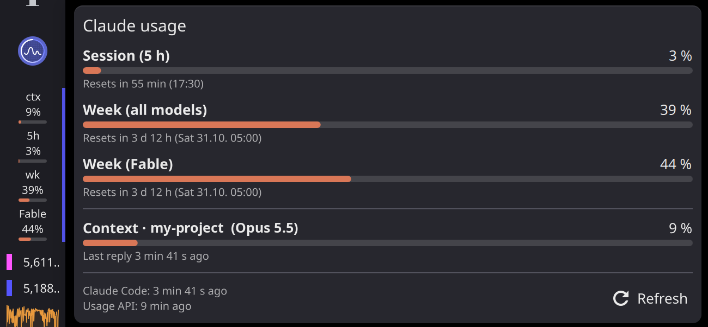

# claude-usage

Your Claude plan limits in the KDE Plasma panel and in the Claude Code status line. Session (5 h),
week, week per model (like Fable) and how full the context of your current Claude Code sessions is,
each with a small bar and when it resets.

I won't bore you with why I built this. If you're curious, there's a [section at the end](#why-i-built-this).



## What you get

- **Status line** in Claude Code, for example `Opus 5.5 · ctx 34% · 5h 7% · wk 20% · Fable 16%`
- **Panel widget** with one number and a thin bar per limit. Works in horizontal and vertical panels.
- **Popup** with bigger bars, reset countdowns, the context of every Claude Code session active in the
  last 30 min, how old the data is and a refresh button
- Colours turn yellow from 70 % and red from 90 %. Colours and thresholds are in the widget settings,
  or use your Plasma theme's colours.

## How it gets the numbers

Most of it comes for free. Claude Code hands the session and weekly limits to its status line on every
reply, `statusline.py` saves them to `~/.cache/claude-usage/state.json` and the widget reads that file.

The per-model weekly limits aren't in there, so `poll.py` asks the same endpoint Claude Code's `/usage`
uses. It does that gently.

- only while you're actually using Claude Code (status line ran or a `claude` process is up in the last 30 min)
- at most every 15 min, checked by a systemd user timer every 5 min
- backs off on errors, 15 min doubling up to 4 h, and honours Retry-After
- the refresh button in the popup asks right away, but never more than once a minute

It reads the OAuth token from `~/.claude/.credentials.json` and only sends it to api.anthropic.com. It
never renews the token, because renewing rotates the refresh token and can log Claude Code out. When the
token has expired the old numbers just stay until Claude Code renews it on its own.

The endpoint isn't documented, so it might change. If it does, the status line part keeps working.

## Install

Needs Python 3, systemd and Plasma 6 for the widget. No extra Python packages.

```sh
git clone https://github.com/flo-coast/claude-usage && cd claude-usage && ./install.sh
```

Then right-click your panel, Add Widgets, search for Claude Usage. The numbers show up with your next
Claude Code reply.

`install.sh` copies the scripts to `~/.local/share/claude-usage`, starts the timer and installs the
widget. It sets the Claude Code status line in `~/.claude/settings.json` (with a backup next to it) only
if you don't have one yet. If you do, it tells you the command and leaves yours alone.

Run `./install.sh` again to update, `./uninstall.sh` to remove everything.

Without Plasma you still get the status line, the widget is just skipped.

## Why I built this

I wanted my limits in the panel instead of typing `/usage` all the time.
The widgets I found poll that endpoint every minute or renew the token themselves, which can log Claude
Code out. So I wanted one that mostly uses what Claude Code already hands out and only asks the API now
and then.

## License

GPL-3.0-or-later, see [LICENSE](LICENSE).

Written by **flo-coast** (2026), with Claude (Anthropic) as a coding assistant.
